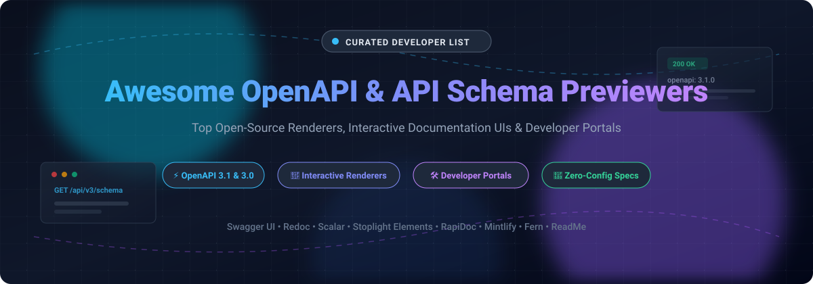

  

# ⚡ Awesome API Schema & OpenAPI Previewer

**A comprehensive, curated collection of top-tier open-source renderers, interactive documentation engines, authoring editors, and enterprise SaaS platforms for visualizing OpenAPI (Swagger), AsyncAPI, and JSON Schema specifications.**

---

## 📑 Table of Contents

- [🌟 Sector Overview & Market Dynamics](#-sector-overview--market-dynamics)
- [💻 Open-Source Renderers & Previewers](#-open-source-renderers--previewers)
- [☁️ SaaS Platforms & Hosted Previewers](#️-saas-platforms--hosted-previewers)
- [📈 Star History](#-star-history)
- [💖 Support & Sponsorship](#-support--sponsorship)
- [🤝 Contributing](#-contributing)
- [📄 License](#-license)

---

## 🌟 Sector Overview & Market Dynamics

The global API management and developer documentation tooling sector is valued between **$8.0B – $10.3B** (projected to reach over $30B+ by 2030 at ~16%–25% CAGR), with North America alone accounting for more than $1B in documentation solutions.

The market displays a **bifurcated, moderately concentrated structure at the enterprise management layer**—where hyper-scalers and established enterprise players (Microsoft Azure, AWS, Google Cloud/Apigee, and Postman) capture the lion's share of end-to-end gateway and lifecycle revenue. In contrast, the market remains **highly fragmented across the documentation, previewer, and DX tooling layer**. In this tier, agile open-source libraries and developer-first SaaS platforms compete actively on user experience, modern frontend frameworks (React, Vue, Web Components), OpenAPI 3.1 support, and AI-native developer capabilities without a winner-take-all dynamic.

---

## 💻 Open-Source Renderers & Previewers

Top open-source engines, UI components, and editors to preview and render OpenAPI and schema definitions locally or embedded inside your applications. Sorted in **descending order by GitHub star count**.

| Tool | Stars | License | Key Strengths & Technical Highlights |
|---|:---:|:---:|---|
| **[Swagger UI](https://github.com/swagger-api/swagger-ui)** |  | Apache-2.0 | 🌐 The original, battle-tested UI for visualizing OpenAPI specifications. Features built-in interactive "Try it out" request executions, client generation hooks, and vast ecosystem compatibility. |
| **[Redoc](https://github.com/Redocly/redoc)** |  | MIT | 📖 Clean three-column responsive layout with sticky hierarchical sidebar navigation. Highly praised as the gold standard for long-form reading, documentation comprehension, and Markdown integration. |
| **[Scalar](https://github.com/scalar/scalar)** |  | MIT | ⚡ Modern, ultra-responsive API reference engine with first-class OpenAPI 3.1 support. Features an integrated REST client, instant search, pre-built framework integrations (Next.js, Fastify, Express, FastAPI), and official ASP.NET Core adoption. |
| **[Swagger Editor](https://github.com/swagger-api/swagger-editor)** |  | Apache-2.0 | ✏️ In-browser visual and split-pane code editor for designing, validating, and authoring OpenAPI/Swagger definitions with instant real-time live previewing. |
| **[Stoplight Prism](https://github.com/stoplightio/prism)** |  | Apache-2.0 | 🎭 High-performance HTTP mock server and contract tester that turns OpenAPI documents into simulated backend APIs for frontend validation before code is written. |
| **[Stoplight Spectral](https://github.com/stoplightio/spectral)** |  | Apache-2.0 | 🔍 Flexible JSON/YAML linter and automated style-guide enforcement engine for OpenAPI v2, v3, and AsyncAPI schemas in CI/CD pipelines. |
| **[Stoplight Elements](https://github.com/stoplightio/elements)** |  | Apache-2.0 | 🧩 Drop-in custom Web Components and React components for seamlessly embedding interactive API docs into existing websites, docs portals, or custom developer portals. |
| **[Microcks](https://github.com/microcks/microcks)** |  | Apache-2.0 | 🧪 Cloud-native Kubernetes-ready platform for API mocking, schema viewing, and contract testing across OpenAPI, AsyncAPI, and GraphQL specifications. |
| **[RapiDoc](https://github.com/rapi-doc/RapiDoc)** |  | MIT | 🚀 Zero-build embeddable web component via a single `<rapi-doc>` HTML tag. Emphasizes near-zero build tooling, fast rendering, rich styling attributes, and an interactive test console. |
| **[Docusaurus OpenAPI Docs](https://github.com/PaloAltoNetworks/docusaurus-openapi-docs)** |  | Apache-2.0 | 📚 Complete plugin suite for Docusaurus v2/v3 that transforms OpenAPI definitions into clean interactive documentation pages with live code generation and dark-mode support. |
| **[RapiPdf](https://github.com/mrin9/RapiPdf)** |  | MIT | 📄 Lightweight web component for generating customized, printable PDF documentation and reference sheets directly from OpenAPI/Swagger specs in the browser. |

---

## ☁️ SaaS Platforms & Hosted Previewers

A comparison of commercial, hosted API documentation platforms and developer portals. Sorted in **descending order by company scale** (valuation / annual recurring revenue).

| Product | Company Scale (Valuation / Revenue) | Pricing (Starting Paid Tier) | Free Tier / Trial Limits | Key Strengths & Focus |
|---|---|---|---|---|
| **[Postman](https://www.postman.com/)** | **$5.6B Valuation** (~$434M total funding raised) | **$9 / user / month** (billed annually, Solo plan) or **$19 / user / month** (billed annually, Team plan) | **Free forever**: 1 user seat, unlimited collection runs, unlimited local/cloud mock servers, native Git sync, 50 AI credits/mo, and up to 1,000 API monitoring requests/mo. | 🏢 Industry-standard API client and workspace with integrated schema documentation preview, API governance, collection runners, and test automation. |
| **[Stoplight (SmartBear)](https://stoplight.io/)** | **$1.8B+ Valuation** ($250M+ ARR, parent SmartBear) | **$39 / month** (billed annually, Starter plan; SwaggerHub at $19/user/month) | **Free forever**: 1 user seat, single workspace, basic API design/mocking/docs preview with limited public/private projects. (Plus a 14-day full Pro trial). | 🎨 Design-first API ecosystem featuring Spectral linting, Prism mock servers, and embeddable Elements renderer. |
| **[Mintlify](https://mintlify.com/)** | **$500M Valuation** (~$23M ARR, Series B) | **$450 / month** (billed annually) or $540 / month (billed monthly, Pro plan) | **Free forever (Starter)**: Up to 5 editor seats, full core docs platform, custom domain support, web editor, GitHub sync, search, MCP server, and interactive API playground (excludes automated AI writing assistant, analytics, and password protection). | 🤖 AI-native documentation platform tailored for modern developer experience, lightning-fast setup, and MDX components. |
| **[Fern](https://buildwithfern.com/)** | **~$33M – $53M Valuation** (~$3.3M ARR; acquired by Postman in Jan 2026) | **Enterprise custom pricing** (previously Team plan at $150/mo; paid tier now sales-led) | **Free forever (Developer)**: Up to 10 team members, 1 site, 1,000 pages, API explorer, web editor, MCP servers, and 250 AI credits/month. | 📦 OpenAPI to interactive docs with built-in, multi-language idiomatic client SDK generation (TypeScript, Python, Go, Java). |
| **[ReadMe](https://readme.com/)** | **~$10M+ ARR** (~$10.3M total VC funding) | **$250 / month** (billed annually, Pro plan; 14-day free trial) | **Free forever (Starter)**: 1 project, 1 editor seat, custom domain, bi-directional Git sync, interactive API reference, customizable themes, 7-day analytics, and `llms.txt`/MCP server. | 📊 Interactive API developer portals with personalized API key injection, metrics/API logs explorer, and live playgrounds. |
| **[Scalar (Hosted)](https://scalar.com/)** | **Seed-stage Startup** (~16.4k GitHub stars on open-source engine) | **$150 / month** ($125/mo billed annually, Pro plan; starts with 7-day trial) | **Free forever**: Up to 3 APIs, 1 editor seat, 1 SDK target up to 25 endpoints, beautiful hosted docs, and landing page generator. | 🚀 Ultra-fast OpenAPI 3.1 & 3.0 renderer with built-in modern API client, search, and native framework adapters. |
| **[Redocly](https://redocly.com/)** | **Bootstrapped / Profitable Scale-up** (Seed funded ~$2.8M) | **$249 / month** (billed annually at $2,988/yr, Pro plan) | **No permanent free hosted tier** (offers a **30-day free trial** of Pro/Scale plans with no credit card required; core Redoc CE renderer is free and open source forever). | 🏛️ Enterprise-grade API documentation portals, multi-format (OpenAPI, GraphQL, AsyncAPI) support, and flat-rate pricing with unlimited seats. |

---

## 📈 Star History

---

## 💖 Support & Sponsorship

Thank you so much for exploring and supporting this curated collection! If you find this repository helpful for your API projects, please consider supporting the project:

- ⭐ **Star this repository** to help others discover it on GitHub.
- 🍴 **Fork and share** with your teammates, colleagues, and developer communities.
- ☕ **Buy me a coffee / Sponsor**: If this project helped your workflow, you can sponsor further open-source development directly via the [GitHub Sponsor Dashboard](https://github.com/sponsors/ishandutta2007).

Your backing and feedback keep open-source developer tooling thriving!

---

## 🤝 Contributing

Contributions are always welcome! 

1. Review existing tools to prevent duplicate entries.
2. Fork the repository and create your feature branch: `git checkout -b feature/add-new-tool`.
3. Ensure accurate open-source licenses, star badges, and verified pricing details.
4. Submit a Pull Request with a short description of the tool and why it belongs here.

---

## 📄 License

Distributed under the MIT License. See [`LICENSE`](./LICENSE) for full information.
